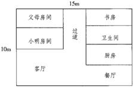

# Mathematics (Grade 6)

**ID**: 853c328d
**难度**: medium_hard
**题型**: fill_in_the_blank

## 题目
如图是小明家的平面结构图，量一量图上的距离，算一算这个图的比例尺是$\underline{\hspace{5em}}$．再算一算实际面积大约是$\underline{\hspace{5em}}$．

## 解答

**答案**: 1：250, 150平方米

1. Step1:经测量得到图上长方形的宽为4厘米
2. Step2:将实际的宽10米换算为1000厘米
3. Step3:根据比例尺=图上距离:实际距离，计算比例尺为4厘米:1000厘米，化简得到1:250
4. Step4:已知图上长方形长和宽对应的实际长度分别为15米和10米
5. Step5:根据长方形面积公式，计算实际面积为10×15 = 150平方米

## 知识点

**知识点**:
  - 比例尺；长度的测量方法；长方形、正方形的面积．

---
