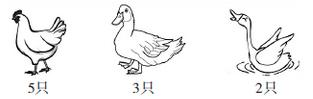

# Mathematics (Grade 6)

**ID**: 8f330b7d
**难度**: medium_hard
**题型**: fill_in_the_blank

## 题目
解决生活中的问题

1.鸡和鸭一共有（）只。
□○□=□（只）
2.鹅比鸡少（）只。
□○□=□（只）
3. 鸡、鸭和鹅一共有（）只。
□○□○□=□（只）

## 解答

**答案**: 8, 3, 10

1. Step1:题目中已知鸡有5只，鸭有3只，求鸡和鸭一共有多少只，根据加法的意义，把鸡和鸭的数量合并起来，用加法计算，即5 + 3 = 8只
2. Step2:已知鸡有5只，鹅有2只，求鹅比鸡少多少只，根据“少多少”就是用大数减去小数，用鸡的数量减去鹅的数量，即5 - 2 = 3只
3. Step3:已知鸡有5只，鸭有3只，鹅有2只，求鸡、鸭和鹅一共有多少只，把鸡、鸭、鹅的数量合并起来，用加法计算，即5 + 3 + 2 = 10只

## 知识点

**知识点**:
  - 整数的加法和减法

---
