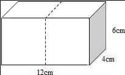

# Mathematics (Grade 6)

**ID**: a0f175f4
**难度**: medium_hard
**题型**: fill_in_the_blank

## 题目
如图，长方体的长是12cm，宽是4cm，高是6cm，把这个长方体沿虚线剪开，剪开后的两个小长方体的表面积的和比原来的长方体增加了$\underline{\hspace{5em}}$平方厘米．

## 解答

**答案**: 48

1. Step1:明确长方体沿虚线剪开后，表面积增加的部分是两个长为6cm、宽为4cm的长方形的面积
2. Step2:根据长方形面积公式，长方形面积=长×宽，计算一个长为6cm、宽为4cm的长方形的面积，即6×4=24平方厘米
3. Step3:计算增加的两个长方形的总面积，即24×2=48平方厘米

## 知识点

**知识点**:
  - 长方体和正方体的表面积．

---
