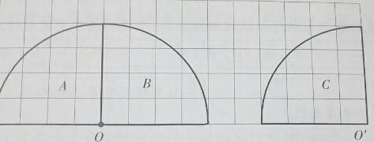

# Mathematics (Grade 6)

**ID**: a5cc9bd5
**难度**: medium_hard
**题型**: fill_in_the_blank

## 题目
观察下面方格纸中图形的运动，并填空.

 （1）图形A绕点O（    ）时针旋转（    ）度后，得到图形B。
 （2）图形A向右（    ）平移（    ）格，得到图形C。
 （3）图形B先绕点O逆时针旋转（    ）度，再向右平移（    ）格后，得到图形C。

## 解答

**答案**: 顺, 90, O点, 10, 90, 10

1. Step1:观察图形A和图形B的位置关系，发现图形A绕点O顺时针方向转动后能与图形B重合，确定旋转方向为顺时针
2. Step2:进一步观察图形A和图形B，根据方格纸及图形特征，确定图形A绕点O顺时针旋转90度后得到图形B
3. Step3:对比图形A和图形C的位置，得出图形A以O点为参照向右平移
4. Step4:通过数方格，明确图形A向右O点平移10格得到图形C
5. Step5:观察图形B和图形C的关系，先考虑图形B的旋转，发现图形B绕点O逆时针旋转90度能使其方向与图形C对应
6. Step6:再看图形B旋转后与图形C的位置差异，得出图形B旋转后再向右平移10格得到图形C

## 知识点

**知识点**:
  - 

---
