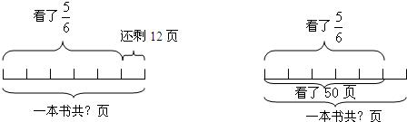

# Mathematics (Grade 6)

**ID**: a5dc1846
**难度**: medium_hard
**题型**: fill_in_the_blank

## 题目
看图只列式不计算．

## 解答

**答案**: 12÷(1−5/6), 50÷5/6

1. Step1:分析第一个图，把这本书的总页数看作单位'1'，看了\(rac{5}{6}\)，则剩下的页数占总页数的\(1 - rac{5}{6}\)，已知剩下12页，根据分数除法的意义，求总页数列式为\(12÷(1−rac{5}{6})\)。
2. Step2:分析第二个图，把这本书的总页数看作单位'1'，看了\(rac{5}{6}\)，已知看了50页，根据分数除法的意义，求总页数列式为\(50÷rac{5}{6}\)。

## 知识点

**知识点**:
  - 图文应用题．

---
