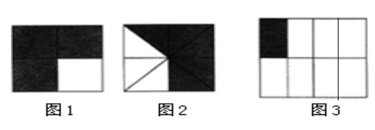

# Mathematics (Grade 6)

**ID**: a879001a
**难度**: medium_hard
**题型**: fill_in_the_blank

## 题目
如图每个大长方形都表示“1”，分别用分数、小数和百分数表示图中的涂色部分。

图1：分数（______） 小数（______） 百分数（______）
图2: 分数（______） 小数（______） 百分数（______）
图3：分数（______） 小数（______） 百分数（______）

## 解答

**答案**: 3/4, 0.75, 75%, 5/8, 0.625, 62.5%, 1/8, 0.125, 12.5%

1. Step1:观察图1，大长方形被平均分成4份，涂色部分是3份，所以用分数表示为3/4
2. Step2:将3/4化为小数，3÷4 = 0.75
3. Step3:将0.75化为百分数，0.75×100% = 75%
4. Step4:观察图2，大长方形被平均分成8份，涂色部分是5份，所以用分数表示为5/8
5. Step5:将5/8化为小数，5÷8 = 0.625
6. Step6:将0.625化为百分数，0.625×100% = 62.5%
7. Step7:观察图3，大长方形被平均分成8份，涂色部分是1份，所以用分数表示为1/8
8. Step8:将1/8化为小数，1÷8 = 0.125
9. Step9:将0.125化为百分数，0.125×100% = 12.5%

## 知识点

**知识点**:
  - 

---
