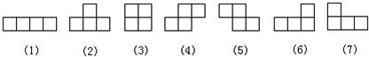

# Mathematics (Grade 6)

**ID**: a8a2f989
**难度**: medium_hard
**题型**: fill_in_the_blank

## 题目
用方格纸剪成面积是4的图形，其形状只能有如下七种：

如果用其中的四种拼成一个面积是16的正方形，那么，这四种图形的编号和的最大值是$\underline{\hspace{5em}}$．

## 解答

**答案**: 19

1. Step1:明确要从七种面积是4的图形中选四种拼成面积是16的正方形
2. Step2:找出所有能拼成面积是16的正方形的四种图形组合，分别为（1），（5），（6），（7）；（1），（4），（6），（7）；（1），（3），（6），（7）
3. Step3:分别计算三种组合的编号和，（1 + 5 + 6 + 7 = 19），（1 + 4 + 6 + 7 = 18），（1 + 3 + 6 + 7 = 17）
4. Step4:比较三种组合编号和的大小，19＞18＞17，得出最大值为19

## 知识点

**知识点**:
  - 图形的拆拼（切拼）；数字和问题．

---
