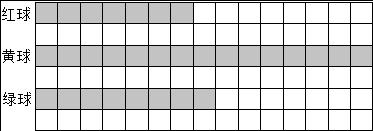

# Mathematics (Grade 6)

**ID**: a9f49326
**难度**: medium_hard
**题型**: fill_in_the_blank

## 题目
在一个口袋里，装有4个同样大小球，小明每次任意摸1个球，摸30次．他把摸到每种球的次数画成了下面的条形图（每格表示1次）

（1）根据条形图，把下面的统计表填写完整．
$\begin{array}{|c|c|c|c|c|}
\hline
名称 & 合计 & 红球 & 黄球 & 绿球 \\ \hline
次数 & $\underline{\hspace{5em}}$30 & $\underline{\hspace{5em}}$7 & $\underline{\hspace{5em}}$15 & $\underline{\hspace{5em}}$8 \\ \hline
\end{array}$（2）$\underline{\hspace{5em}}$黄球经常摸到，摸到$\underline{\hspace{5em}}$红球和$\underline{\hspace{5em}}$绿球的次数差不多．
（3）小明可能放了$\underline{\hspace{5em}}$1个红球，$\underline{\hspace{5em}}$2个黄球，$\underline{\hspace{5em}}$1个绿球．

## 解答

**答案**: 30, 7, 15, 8, 黄, 红, 绿, 1, 2, 1

1. Step1:观察条形图，因为每格表示1次，数出红球对应的格数为7，所以红球次数是7
2. Step2:数出黄球对应的格数为15，所以黄球次数是15
3. Step3:数出绿球对应的格数为8，所以绿球次数是8
4. Step4:已知摸球总次数为30次，将其填入合计次数处
5. Step5:比较三种球的次数，15最大，所以经常摸到的是黄球
6. Step6:7和8比较接近，所以摸到次数差不多的是红球和绿球
7. Step7:根据摸到次数推测球的数量，7和8接近，15相对较大，推测可能放了1个红球，2个黄球，1个绿球

## 知识点

**知识点**:
  - 以一当五（或以上）的条形统计图

---
