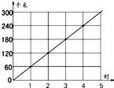

# Mathematics (Grade 6)

**ID**: acf6d1e3
**难度**: medium_hard
**题型**: fill_in_the_blank

## 题目
如图表示的是一辆汽车在公路上行驶的时间与路程的关系．这辆汽车每小时行驶的速度是$\underline{\hspace{5em}}$，它行驶的路程和时间成$\underline{\hspace{5em}}$比例．照这样计算，这辆汽车6小时行驶$\underline{\hspace{5em}}$千米．

## 解答

**答案**: 60千米, 正, 360

1. Step1:观察统计图，发现汽车匀速行驶，根据图中数据可知每小时行驶的速度是60千米
2. Step2:因为速度一定，根据正比例的定义，当两个量的比值一定时成正比例，所以行驶的路程和时间成正比例
3. Step3:已知速度为每小时60千米，时间为6小时，根据路程=速度×时间，可得60×6 = 360千米，即这辆汽车6小时行驶360千米

## 知识点

**知识点**:
  - 从统计图表中获取信息；辨识成正比例的量与成反比例的量．

---
