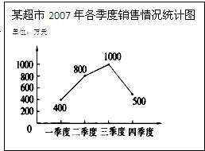

# Mathematics (Grade 6)

**ID**: af14a583
**难度**: medium_hard
**题型**: fill_in_the_blank

## 题目
如图是(    )统计图，从图中可知道该超市2007年平均每月销售额是(    )万元，第二季度销售额约占全年的(    )%，第二季度比第三季度少(    )，第(    )季度到(    )季度销售量呈上升趋势．

## 解答

**答案**: 折线, 225, 29.6, 1/5, 一, 三

1. Step1:观察统计图的形状，判断出是折线统计图
2. Step2:计算全年销售额，400+800+1000+500=2700万元
3. Step3:计算2007年平均每月销售额，2700÷12=225万元
4. Step4:计算第二季度销售额占全年的比例，800÷2700≈0.296，转化为百分数是29.6%
5. Step5:计算第二季度比第三季度少的比例，(1000 - 800)÷1000=200÷1000=1/5
6. Step6:观察折线统计图，得出第一季度到第三季度销售量呈上升趋势

## 知识点

**知识点**:
  - 两种不同形式的单式条形统计图；从统计图表中获取信息．

---
