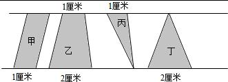

# Mathematics (Grade 6)

**ID**: af82e0a5
**难度**: medium_hard
**题型**: fill_in_the_blank

## 题目
在两条平行线间，有甲、乙、丙、丁四个图形
（如图）．甲与$\underline{\hspace{5em}}$的面积相等，$\underline{\hspace{5em}}$的面积是丙面积的2倍．

## 解答

**答案**: 丁, 甲、丁

1. Step1:根据图意和解析2，可知这几个图形高都相等，假设高为6
2. Step2:根据梯形面积公式（上底 + 下底）×高÷2，计算梯形乙的面积，即（2 + 1）×6÷2 = 9
3. Step3:根据平行四边形面积公式底×高，计算平行四边形甲的面积，即1×6 = 6
4. Step4:根据三角形面积公式底×高÷2，计算三角形丙的面积，即1×6÷2 = 3
5. Step5:根据三角形面积公式底×高÷2，计算三角形丁的面积，即2×6÷2 = 6
6. Step6:比较甲、乙、丙、丁的面积大小，得出甲与丁的面积相等，且甲、丁的面积是丙面积的2倍

## 知识点

**知识点**:
  - 面积及面积的大小比较．

---
