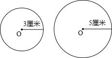

# Mathematics (Grade 6)

**ID**: b19bb371
**难度**: medium_hard
**题型**: fill_in_the_blank

## 题目
两个圆的半径分别是3cm和5cm，它们的直径的比是$\underline{\hspace{5em}}$，周长的比是$\underline{\hspace{5em}}$，面积的比是$\underline{\hspace{5em}}$．

## 解答

**答案**: 3：5, 3：5, 9：25

1. Step1:根据圆的直径公式d = 2r，计算半径为3cm的圆的直径为2×3 = 6cm
2. Step2:根据圆的直径公式d = 2r，计算半径为5cm的圆的直径为2×5 = 10cm
3. Step3:求两圆直径的比为6：10 = 3：5
4. Step4:根据圆的周长公式C = 2πr，计算半径为3cm的圆的周长为2π×3
5. Step5:根据圆的周长公式C = 2πr，计算半径为5cm的圆的周长为2π×5
6. Step6:求两圆周长的比为2π×3：2π×5 = 3：5
7. Step7:根据圆的面积公式S = πr²，计算半径为3cm的圆的面积为π×3² = 9π
8. Step8:根据圆的面积公式S = πr²，计算半径为5cm的圆的面积为π×5² = 25π
9. Step9:求两圆面积的比为9π：25π = 9：25

## 知识点

**知识点**:
  - 圆、圆环的周长；比的应用；圆、圆环的面积．

---
