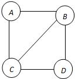

# Mathematics (Grade 6)

**ID**: b2da666b
**难度**: medium_hard
**题型**: fill_in_the_blank

## 题目
将0～5这6个数字中的4个数字填入如图的圆圈中，每条线段两端的数字作差（大减小），可以得到5个差，这5个差恰好为1-5，在所有满足条件的填法中，四位数的最大值是$\underline{\hspace{5em}}$．

## 解答

**答案**: 5034

1. Step1:要使四位数ABCD最大，首先确定千位数字A应取0 - 5这6个数字中的最大值，所以A = 5
2. Step2:因为B和C中有一个为0，且B是百位数字要尽量大，先假设B = 4，此时C = 0，发现D无法填出
3. Step3:调整B的值，得出B最大为3，当B = 3时，C = 0
4. Step4:当A = 5，B = 3，C = 0时，可推出D = 4
5. Step5:所以满足条件的最大四位数是5034

## 知识点

**知识点**:
  - 最大与最小．

---
