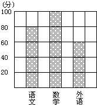

# Mathematics (Grade 6)

**ID**: b8dc105d
**难度**: medium_hard
**题型**: fill_in_the_blank

## 题目
如图是小红各科考试成绩的统计图，根据统计图回答下列问题．
（1）语文(    )分、数学(    )分、外语(    )分．
（2）数学比外语高(    )分．
（3）三科平均(    )分．

## 解答

**答案**: 80, 100, 60, 40, 80

1. Step1:观察统计图，得出语文成绩为80分
2. Step2:观察统计图，得出数学成绩为100分
3. Step3:观察统计图，得出外语成绩为60分
4. Step4:用数学成绩100分减去外语成绩60分，即100 - 60 = 40分，得到数学比外语高的分数
5. Step5:计算三科总成绩为80 + 100 + 60 = 240分
6. Step6:用三科总成绩240分除以科数3，即240÷3 = 80分，得到三科平均分

## 知识点

**知识点**:
  - 以一当五（或以上）的条形统计图．

---
