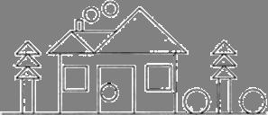

# Mathematics (Grade 6)

**ID**: bb376a51
**难度**: medium_hard
**题型**: fill_in_the_blank

## 题目
数一数，填一填

$\begin{array}{|c|c|c|c|c|}
\hline
长方形
 & 正方形
 & 三角形
 & 圆
 & 平行四边形
 \\\hline
（\underline{\hspace{5em}}）个
 & （\underline{\hspace{5em}}）个
 & （\underline{\hspace{5em}}）个
 & （\underline{\hspace{5em}}）个
 & （\underline{\hspace{5em}}）个
 \\\hline
\end{array}$

## 解答

**答案**: 5, 2, 9, 5, 4

1. Step1:观察图形，数出长方形的个数为5
2. Step2:数出正方形的个数为2
3. Step3:数出三角形的个数为9
4. Step4:数出圆的个数为5
5. Step5:数出平行四边形的个数为4

## 知识点

**知识点**:
  - 小学数学;图形与几何;平面图形;平面图形的认识及分类

---
