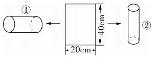

# Mathematics (Grade 6)

**ID**: bc1b0bc0
**难度**: medium_hard
**题型**: fill_in_the_blank

## 题目
把一张长40厘米、宽20厘米的长方形纸卷成一个圆柱， 有两种卷法（都没有重叠），如下图。

1.①号圆柱的高是（），底面圆的周长是（）。
2.②号圆柱的高是（），底面周长是（）。
3.两个圆柱的侧面积分别是多少？

## 解答

**答案**: 20cm, 40cm, 40cm, 20cm, 800cm^2

1. Step1:观察图形可知，①号圆柱是沿长方形长边卷成，所以①号圆柱的高是长方形的宽，即20cm
2. Step2:①号圆柱底面圆的周长是长方形的长，即40cm
3. Step3:②号圆柱是沿长方形宽边卷成，所以②号圆柱的高是长方形的长，即40cm
4. Step4:②号圆柱底面周长是长方形的宽，即20cm
5. Step5:因为圆柱侧面是长方形，根据长方形面积公式，两个圆柱侧面积都为40×20 = 800cm²

## 知识点

**知识点**:
  - 圆柱与圆锥的展开图

---
