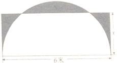

# Mathematics (Grade 6)

**ID**: bd32fe90
**难度**: medium_hard
**题型**: fill_in_the_blank

## 题目
如图，S=$S_{1}$+$S_{2}$，求图形中矩形的宽x．（保留两位小数）

## 解答

**答案**: 2.36

1. Step1:先计算半圆的半径，由图可知直径为6米，所以半径为6÷2 = 3米
2. Step2:根据圆的面积公式S = πr²，计算半圆的面积，即3.14×3²÷2 = 3.14×9÷2 = 14.13平方米
3. Step3:因为长方形的面积等于半圆的面积，且长方形面积公式为S = 长×宽，已知长为6米，所以宽 = 半圆面积÷长，即14.13÷6 ≈ 2.36米

## 知识点

**知识点**:
  - 组合图形的面积

---
