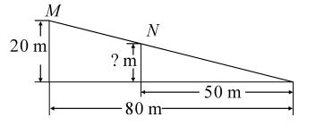

# Mathematics (Grade 6)

**ID**: bdcbca8f
**难度**: medium_hard
**题型**: fill_in_the_blank

## 题目
下图是一个山坡的示意图（假定山坡的坡度处处相等），如果M点距地面的高度是20m，那么N点距地面的高度应是多少？

## 解答

**答案**: 12.5

1. Step1:因为山坡坡度处处相等，所以对应的高度和水平距离成比例关系
2. Step2:设N点距地面的高度是x米
3. Step3:根据比例关系列出20:x = 80:50
4. Step4:根据比例的性质，内项之积等于外项之积，可得80x = 20×50
5. Step5:计算20×50 = 1000
6. Step6:则80x = 1000，求解x，x = 1000÷80
7. Step7:计算1000÷80 = 12.5，得出x = 12.5

## 知识点

**知识点**:
  - 解比例

---
