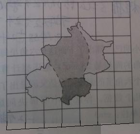

# Mathematics (Grade 6)

**ID**: bed3640f
**难度**: medium_hard
**题型**: fill_in_the_blank

## 题目
下面是一张街心公园地图．（ 图中每个小方格的边长为1cm）
 （1）它的面积大约是（    ）平方厘米；
 （2）公园划分为4个区域，其中最大的是健身区，公园的面积大约是16000平方米，你能根据公园地图，估计出健身区的面积大约是多少平方米吗？

## 解答

**答案**: 12, 8000

1. Step1:数出街心公园地图中满格的数量为5个，半格的数量为14个
2. Step2:根据每个满格是1平方厘米，每个半格是0.5平方厘米，计算公园面积为5 + 0.5×14 = 12平方厘米
3. Step3:数出健身区地图中满格的数量为2个，半格的数量为8个
4. Step4:计算健身区面积为2 + 0.5×8 = 6平方厘米
5. Step5:计算健身区面积与公园面积的比率为6÷12
6. Step6:已知公园面积大约是16000平方米，根据比率计算健身区面积为16000×(6÷12) = 8000平方米

## 知识点

**知识点**:
  - --

---
