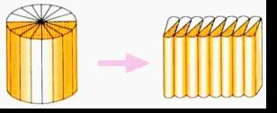

# Mathematics (Grade 6)

**ID**: bfe61dbb
**难度**: medium_hard
**题型**: fill_in_the_blank

## 题目
将一个圆柱分成若干等份后，拼成一个近似长方体，这个长方体的高为5厘米，表面积比圆柱多20平方厘米，圆柱的体积是 $\underline{\hspace{5em}}$ 立方厘米．

## 解答

**答案**: 62.8

1. Step1:分析可知把圆柱切拼成长方体后，表面积增加的是两个切面的面积，且每个切面的长等于圆柱的高，切面的宽等于圆柱的底面半径
2. Step2:根据表面积比圆柱多20平方厘米，可计算圆柱底面半径，即20÷2÷5 = 2厘米
3. Step3:根据圆柱体积公式v = sh = 3.14×r²×h，其中r = 2厘米，h = 5厘米，计算体积为3.14×2²×5 = 3.14×4×5 = 62.8立方厘米

## 知识点

**知识点**:
  - 圆柱的侧面积、表面积和体积

---
