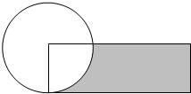

# Mathematics (Grade 6)

**ID**: c18f9178
**难度**: medium_hard
**题型**: fill_in_the_blank

## 题目
如图中圆的面积等于长方形的面积，已知圆的周长是32厘米，那么图中的阴影部分的周长是$\underline{\hspace{5em}}$      厘米

## 解答

**答案**: 40

1. Step1:根据圆的周长公式$C = 2\pi r$（其中$C$为周长，$r$为半径），已知圆的周长是32厘米，可得出圆的半径$r=\frac{32}{2\pi}$。
2. Step2:由圆的面积公式$S=\pi r^2$，且圆的面积等于长方形的面积，长方形的宽等于圆的半径$r$，可推出长方形的长为$\pi r$。
3. Step3:把长方形的宽移到上方的长上，分析阴影部分的周长组成，发现阴影部分的周长等于圆的周长加上圆周长的$\frac{1}{4}$。
4. Step4:计算阴影部分的周长，即$32 + 32×\frac{1}{4}=32 + 8 = 40$厘米。

## 知识点

**知识点**:
  - 圆、圆环的面积;长方形的周长;圆、圆环的周长

---
