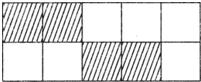

# Mathematics (Grade 6)

**ID**: c43b4651
**难度**: medium_hard
**题型**: fill_in_the_blank

## 题目
你能看图填空吗？试一试．用分数、小数和百分数分别表示图中阴影部分并回答问题．
分数(    )；小数(    )；百分数(    )．
（1）空白部分比阴影多百分之几？
（2）阴影部分占总图形的百分之几？

## 解答

**答案**: $\frac{4}{10}$, 0.4, 40%, 50%, 40%

1. Step1:观察图形可知，图中把单位'1'平均分成了10份，阴影部分占4份，所以用分数表示阴影部分为$\frac{4}{10}$
2. Step2:将分数$\frac{4}{10}$化为小数，4÷10 = 0.4
3. Step3:将分数$\frac{4}{10}$化为百分数，$\frac{4}{10}$=$\frac{40}{100}$=40%
4. Step4:空白部分有6份，即$\frac{6}{10}$，求空白部分比阴影多百分之几，把阴影部分看作单位'1'，根据公式（大数 - 小数）÷单位'1'的量，可得（$\frac{6}{10}$-$\frac{4}{10}$）÷$\frac{4}{10}$=$\frac{2}{10}$÷$\frac{4}{10}$=0.5 = 50%
5. Step5:由前面计算可知阴影部分占总图形的40%

## 知识点

**知识点**:
  - 百分数的意义、读写及应用；小数、分数和百分数之间的关系及其转化．

---
