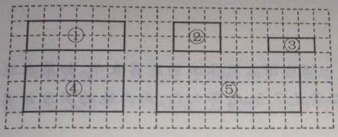

# Mathematics (Grade 6)

**ID**: c5e64a3a
**难度**: medium_hard
**题型**: fill_in_the_blank

## 题目
观察下面五个长方形。

 （1）图中（    ）号长方形是①号长方形放大后的图形，它是按（    ）：（    ）的比例放大的。
 （2）图中（    ）号长方形是①号长方形缩小后的图形，它是按（    ）：（    ）的比例缩小的。
 （3）图中④号长方形能按比例缩小变成②号长方形吗？为什么?

## 解答

**答案**: ④, 1, 1.5, ②, 2, 1

1. Step1:观察①号长方形和其他长方形的长和宽的关系，判断哪个是①号长方形放大后的图形，得出图中④号长方形是①号长方形放大后的图形
2. Step2:确定④号长方形是①号长方形放大后的图形后，计算其放大比例，得出放大比例是1：1.5
3. Step3:观察①号长方形和其他长方形的长和宽的关系，判断哪个是①号长方形缩小后的图形，得出图中②号长方形是①号长方形缩小后的图形
4. Step4:确定②号长方形是①号长方形缩小后的图形后，计算其缩小比例，得出缩小比例是2：1

## 知识点

**知识点**:
  - 

---
