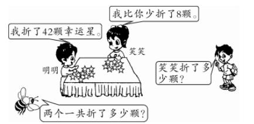

# Mathematics (Grade 6)

**ID**: c60f3ae7
**难度**: medium_hard
**题型**: fill_in_the_blank

## 题目
生活中的数学。  

## 解答

**答案**: 34, 76

1. Step1:根据已知条件，笑笑比明明少折8颗，明明折了42颗，求笑笑折的颗数，用减法，即42 - 8 = 34颗
2. Step2:求两人一共折的颗数，用笑笑折的颗数加上明明折的颗数，即34 + 42 = 76颗

## 知识点

**知识点**:
  - 整数的加法和减法

---
