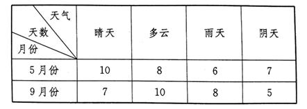

# Mathematics (Grade 6)

**ID**: c71d2f4d
**难度**: medium_hard
**题型**: fill_in_the_blank

## 题目
下面是某地5月份和9月份的天气记录。

（1）5月份（______）天数最多。9月份（______）天数最少。
（2）5月份晴天比9月份多（______）天，9月份阴天比5月份少（______）天。
（3）9月份一共有（______）天，其中有（______）天不下雨。
（4）5月份一共有（______）天，其中有（______）天不下雨。

## 解答

**答案**: 晴天, 阴天, 3, 2, 30, 22, 31, 25

1. Step1:观察5月份各天气的天数，晴天10天，多云8天，雨天6天，阴天7天，比较可得5月份晴天天数最多
2. Step2:观察9月份各天气的天数，晴天7天，多云10天，雨天8天，阴天5天，比较可得9月份阴天天数最少
3. Step3:5月份晴天10天，9月份晴天7天，10 - 7 = 3，所以5月份晴天比9月份多3天
4. Step4:9月份阴天5天，5月份阴天7天，7 - 5 = 2，所以9月份阴天比5月份少2天
5. Step5:9月份天数为7 + 10 + 8 + 5 = 30天
6. Step6:9月份不下雨的天数为晴天7天、多云10天、阴天5天的总和，即7 + 10 + 5 = 22天
7. Step7:5月份天数为10 + 8 + 6 + 7 = 31天
8. Step8:5月份不下雨的天数为晴天10天、多云8天、阴天7天的总和，即10 + 8 + 7 = 25天

## 知识点

**知识点**:
  - 小学数学;统计和概率;统计;统计图表的综合应用

---
