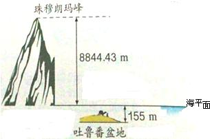

# Mathematics (Grade 6)

**ID**: ca8afc71
**难度**: medium_hard
**题型**: fill_in_the_blank

## 题目
通常，我们规定海平面的海拔高度为0米，高于海平面的为正．珠穆朗玛峰的海拔高度为 $\underline{\hspace{5em}}$ m，吐鲁番盆地的海拔高度为 $\underline{\hspace{5em}}$ m．

## 解答

**答案**: +8844.43, -155

1. Step1:明确规定海平面的海拔高度为0米，高于海平面为正
2. Step2:珠穆朗玛峰高于海平面8844.43米，所以其海拔高度记为+8844.43m
3. Step3:吐鲁番盆地低于海平面155米，根据负数的意义，海平面以下记作“-”，所以其海拔高度记为-155m

## 知识点

**知识点**:
  - 负数的意义及其应用

---
