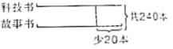

# Mathematics (Grade 6)

**ID**: cdac1a75
**难度**: medium_hard
**题型**: fill_in_the_blank

## 题目
图中科技书和故事书一共240本，故事书比科技书少20本，科技书有（______）本，故事书有（______）本。

## 解答

**答案**: 130, 110

1. Step1:明确已知条件为科技书和故事书总数是240本，故事书比科技书少20本
2. Step2:根据和差问题公式（两数和－差）÷2＝较小数，这里较小数是故事书数量，即(240 - 20)÷2 = 110本
3. Step3:用总数240本减去故事书的110本，得到科技书数量为240 - 110 = 130本

## 知识点

**知识点**:
  - 小学数学;数与代数;应用题;常见的数学问题;和差倍问题

---
