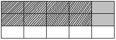

# Mathematics (Grade 6)

**ID**: ce4adabb
**难度**: medium_hard
**题型**: fill_in_the_blank

## 题目
如图中的整个长方形表示“1”，根据图中的斜线部分完成乘法算式．
$\frac{2}{3}$×$\frac{()}{()}$=$\frac{()}{()}$．

## 解答

**答案**: 4/5, 8/15

1. Step1:把大长方形看作“1”，将其平均分成3份，取其中2份，得到$\frac{2}{3}$
2. Step2:观察发现斜线部分是把前面取的2份又平均分成5份，取其中4份，所以这部分占比为$\frac{4}{5}$
3. Step3:根据分数乘法意义，图中斜线部分对应的乘法算式为$\frac{2}{3}×\frac{4}{5}$
4. Step4:计算$\frac{2}{3}×\frac{4}{5}$的结果为$\frac{8}{15}$
5. Step5:得出答案为$\frac{4}{5}$和$\frac{8}{15}$
## 知识点

**知识点**:
  - 分数乘法

---
