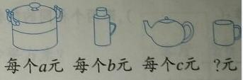

# Mathematics (Grade 6)

**ID**: ce59c359
**难度**: medium_hard
**题型**: fill_in_the_blank

## 题目
看图回答问题。
 1.1个锅比1个茶壶贵(    )元。
 2.买4个热水瓶一共需要(    )元。
 3.一个茶杯比一个茶壶便宜25元，一个茶杯多少元？当c=40元时，一个茶杯多少元？

 每个a元  每个b元    每个c元

## 解答

**答案**: a-c, 4b, c-25, 15

1. Step1:求1个锅比1个茶壶贵多少元，已知锅每个a元，茶壶每个c元，根据一个比另一个多多少用减法，可得1个锅比1个茶壶贵(a - c)元
2. Step2:求买4个热水瓶一共需要多少元，已知热水瓶每个b元，根据总价=单价×数量，可得买4个热水瓶一共需要4b元
3. Step3:求一个茶杯多少元，已知一个茶杯比一个茶壶便宜25元，茶壶每个c元，所以一个茶杯(c - 25)元
4. Step4:当c = 40元时，求一个茶杯的价格，将c = 40代入c - 25，可得40 - 25 = 15元

## 知识点

**知识点**:
  - --

---
