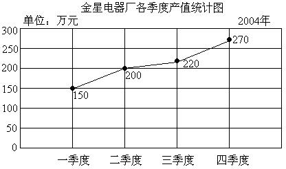

# Mathematics (Grade 6)

**ID**: d0078884
**难度**: medium_hard
**题型**: fill_in_the_blank

## 题目
下面是金星电器厂2004年各季度产值统计图，看图回答下面的问题。

（1）第四季度的产值比第一季度多____万元。
（2）平均每季度的产值是____万元。   
（3）平均每月的产值是____万元。

## 解答

**答案**: 120, 210, 70

1. Step1:从统计图可知第四季度产值为270万元，第一季度产值为150万元，用减法计算第四季度比第一季度多的产值，即270 - 150 = 120万元
2. Step2:先计算总产值为150 + 200 + 220 + 270 = 840万元，再用总产值除以4得到平均每季度的产值，即840÷4 = 210万元
3. Step3:同样先计算总产值为150 + 200 + 220 + 270 = 840万元，然后用总产值除以12得到平均每月的产值，即840÷12 = 70万元

## 知识点

**知识点**:
  - 小学数学;统计和概率;统计;统计图;单式折线统计图

---
