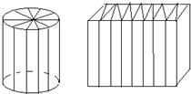

# Mathematics (Grade 6)

**ID**: d03f0a9b
**难度**: medium_hard
**题型**: fill_in_the_blank

## 题目
如图，把圆柱切开拼成一个长方体，已知长方体的长是3.14米，高是2米．这个圆柱体的底面半径是 $\underline{\hspace{5em}}$ 米，体积是 $\underline{\hspace{5em}}$ 立方米．

## 解答

**答案**: 1, 6.28

1. Step1:根据解析2可知长方体的长是圆柱底面周长的一半，已知长方体长为3.14米，所以圆柱底面周长为3.14×2 = 6.28米
2. Step2:根据圆的周长公式C = 2πr（C为周长，r为半径），已知周长C = 6.28米，π取3.14，可得半径r = 6.28÷(2×3.14)=1米
3. Step3:根据圆柱体积公式V = πr²h（V为体积，r为半径，h为高），已知半径r = 1米，高h = 2米，π取3.14，可得体积V = 3.14×1²×2 = 6.28立方米

## 知识点

**知识点**:
  - 圆柱的侧面积、表面积和体积

---
