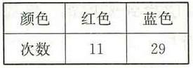

# Mathematics (Grade 6)

**ID**: d31ca579
**难度**: medium_hard
**题型**: fill_in_the_blank

## 题目
盒子里有两种不同颜色的珠子，小小摸了40次，摸珠子的情况如下表．

   根据表中的数据推测，盒子里（  ）色的珠子可能多，（  ）色的珠子可能少．

## 解答

**答案**: 蓝, 红

1. Step1:明确摸珠子的总次数为40次
2. Step2:确定摸到红色珠子的次数是11次
3. Step3:确定摸到蓝色珠子的次数是29次
4. Step4:比较摸到两种颜色珠子的次数，29大于11，即摸到蓝色珠子的次数多于红色珠子的次数
5. Step5:根据当所有情况可能同时发生时，所占比例较大的发生的可能性较大，得出盒子里蓝色的珠子可能多，红色的珠子可能少

## 知识点

**知识点**:
  - 可能性-
-

---
