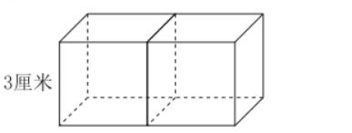

# Mathematics (Grade 6)

**ID**: d3635ee5
**难度**: medium_hard
**题型**: fill_in_the_blank

## 题目
如图将两个正方体拼在一起所用的包装纸比将两个单独包装起来节省（）平方厘米。

## 解答

**答案**: 18

1. Step1:分析题目可知，两个正方体拼在一起时，表面积减少的部分是两个拼接面的面积
2. Step2:由图可知正方体的棱长为3厘米，拼接面为正方形
3. Step3:根据正方形面积公式S = a×a（a为边长），可得一个拼接面的面积为3×3 = 9平方厘米
4. Step4:因为拼接后少了两个拼接面，所以节省的包装纸面积为9×2 = 18平方厘米

## 知识点

**知识点**:
  - 长、正方体的切拼;长方形与正方形的面积

---
