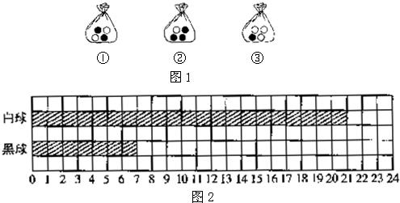

# Mathematics (Grade 6)

**ID**: d5f9a544
**难度**: medium_hard
**题型**: fill_in_the_blank

## 题目
小明从如图1的3个口袋中选了一个，每次从口袋里任意摸一个球．下面条形图记录的是摸到两种颜色球的次数

看图2条形图回答问题．
（1）小明一共摸了(    )次，其中摸到白球(    )次，摸到黑球(    )次．
（2）小明最有可能选的是第(    )号口袋．

## 解答

**答案**: 28, 21, 7, ③

1. Step1:观察图2条形图，可知摸到白球的次数为21次
2. Step2:观察图2条形图，可知摸到黑球的次数为7次
3. Step3:计算一共摸球的次数，21 + 7 = 28次
4. Step4:比较摸到白球和黑球的次数，21＞7，可知摸到白球次数多
5. Step5:观察图1中3个口袋，发现③号口袋中白球数量相对较多，所以小明最有可能选的是第③号口袋

## 知识点

**知识点**:
  - 可能性的大小．

---
