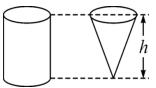

# Mathematics (Grade 6)

**ID**: d619dc3b
**难度**: medium_hard
**题型**: fill_in_the_blank

## 题目
把6L水倒入如图所示的两个容器中，刚好都倒满。这两个容器的底面积和高分别相等，则圆柱形容器的容积是 $\underline{\hspace{5em}}$ L，圆锥形容器的容积是 $\underline{\hspace{5em}}$ L。 

## 解答

**答案**: 4.5, 1.5

1. Step1:根据等底等高的圆柱体积是圆锥体积的3倍，可知水的体积是圆锥体积的3 + 1 = 4倍
2. Step2:计算圆锥形容器的容积，用6÷(3 + 1)=6÷4 = 1.5（L）
3. Step3:计算圆柱形容器的容积，用1.5×3 = 4.5（L）

## 知识点

**知识点**:
  - 

---
