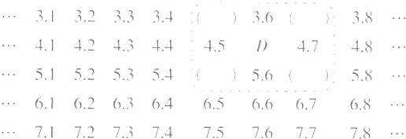

# Mathematics (Grade 6)

**ID**: d72ca2b1
**难度**: medium_hard
**题型**: fill_in_the_blank

## 题目
仔细观察下面的数，你发现这些数的规律了吗？框住的9个数中，如果中间的数用D表示，分别用含有字母D的式子表示括号里的数．

## 解答

**答案**: D-1.1, D-1, D+0.9, D+1.1

1. Step1:观察表格，发现每一行的数后面的数比前面的数多0.1，每一列的数下面的数比上面的数多1
2. Step2:确定中间数D所在位置为第2行第5列，其值为4.6
3. Step3:求第一行第一个括号的数，其在D的左上方，与D相差1.1，所以为D - 1.1
4. Step4:求第一行第二个括号的数，其在D的正上方，与D相差1，所以为D - 1
5. Step5:求第三行第一个括号的数，其在D的左下方，与D相差0.9，所以为D + 0.9
6. Step6:求第三行第二个括号的数，其在D的右下方，与D相差1.1，所以为D + 1.1

## 知识点

**知识点**:
  - 简单图形覆盖现象中的规律；数列中的规律．

---
