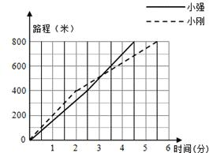

# Mathematics (Grade 6)

**ID**: db19c04c
**难度**: medium_hard
**题型**: fill_in_the_blank

## 题目
小刚和小强赛跑情况如下图所示。

（1）（ ）先到达终点。
（2）请用“快”“慢”来描述比赛情况：小刚是先（ ）后（ ）。
（3）开赛初（ ）领先，开赛（ ）分钟后（ ）领先，比赛中两人相距最远约是（ ）米。

## 解答

**答案**: 小强, 快, 慢, 小刚, 3, 小强, 100

1. Step1:观察赛跑情况图，对比小强和小刚到达终点的时间，小强在4分半到达终点，小刚在5分半到达终点，所以得出小强先到达终点，可填第一个空为小强
2. Step2:根据图中两人速度变化，可知小刚的速度前期较快，后期较慢，所以第二问依次填快、慢
3. Step3:从图中可以看出，在开赛初期小刚的路程领先小强，所以开赛初小刚领先
4. Step4:继续观察图，发现在开赛3分钟后，小强的路程超过了小刚，所以开赛3分钟后小强领先
5. Step5:观察整个比赛过程中两人路程的差距，发现两人相距最远时约为100米，所以最后一个空填100

## 知识点

**知识点**:
  - 

---
