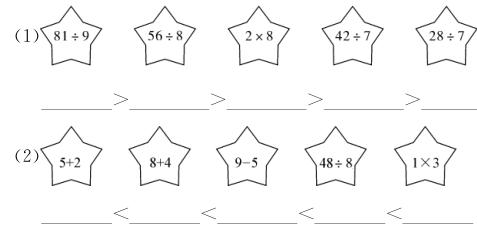

# Mathematics (Grade 6)

**ID**: dd16ab58
**难度**: medium_hard
**题型**: fill_in_the_blank

## 题目
我给星星排顺序。（按要求将算式排序）

## 解答

**答案**: 2×8>81÷9>56÷8>42÷7>28÷7, 1×3<9-5<48÷8<5+2<8+4

1. Step1:计算81÷9，根据表内除法口诀'九九八十一'，可得81÷9=9
2. Step2:计算56÷8，根据表内除法口诀'七八五十六'，可得56÷8=8
3. Step3:计算2×8，根据表内乘法口诀'二八十六'，可得2×8=16
4. Step4:计算42÷7，根据表内除法口诀'六七四十二'，可得42÷7=6
5. Step5:计算28÷7，根据表内除法口诀'四七二十八'，可得28÷7=4
6. Step6:比较9、8、16、6、4的大小，可得16＞9＞8＞6＞4，所以2×8＞81÷9＞56÷8＞42÷7＞28÷7
7. Step7:计算5+2，可得5+2=7
8. Step8:计算8+4，可得8+4=12
9. Step9:计算9-5，可得9-5=4
10. Step10:计算48÷8，根据表内除法口诀'六八四十八'，可得48÷8=6
11. Step11:计算1×3，根据表内乘法口诀'一三得三'，可得1×3=3
12. Step12:比较3、4、6、7、12的大小，可得3＜4＜6＜7＜12，所以1×3＜9-5＜48÷8＜5+2＜8+4

## 知识点

**知识点**:
  - 整数的加法和减法;表内乘法;表内除法;整数大小的比较

---
