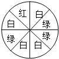

# Mathematics (Grade 6)

**ID**: de1d53ce
**难度**: medium_hard
**题型**: fill_in_the_blank

## 题目
如图，转动转盘，指针停在$\underline{\hspace{5em}}$区域的可能性最大，停在$\underline{\hspace{5em}}$区域的可能性最小．

## 解答

**答案**: 白色, 红色

1. Step1:观察转盘可知，其被分为多个区域，有红、白、绿三种颜色
2. Step2:比较不同颜色区域的面积大小，发现白色区域的面积最大
3. Step3:继续比较，发现红色区域的面积最小
4. Step4:依据‘哪种颜色的区域的面积越大，则指针停在该区域的可能性就越大’这一原理，得出指针停在白色区域的可能性最大
5. Step5:同理，得出指针停在红色区域的可能性最小

## 知识点

**知识点**:
  - 可能性的大小．

---
