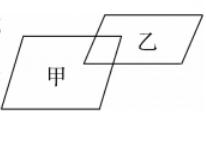

# Mathematics (Grade 6)

**ID**: de5e8709
**难度**: medium_hard
**题型**: fill_in_the_blank

## 题目
如右图，两个平行四边形的重叠部分的面积相当于甲平行四边形面积的$\frac{1}{12}$，相当于乙平行四边形面积的$\frac{1}{8}$，则甲平行四边形与乙平行四边形面积的最简整数比是（）。

## 解答

**答案**: 3:2

1. Step1:设重叠部分的面积为1
2. Step2:根据重叠部分面积相当于甲平行四边形面积的1/12，计算甲平行四边形的面积为1÷(1/12)=12
3. Step3:根据重叠部分面积相当于乙平行四边形面积的1/8，计算乙平行四边形的面积为1÷(1/8)=8
4. Step4:计算甲平行四边形与乙平行四边形的面积比为12:8
5. Step5:将12:8化简为最简整数比3:2

## 知识点

**知识点**:
  - 求比值和化简比

---
