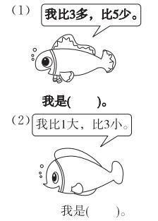

# Mathematics (Grade 6)

**ID**: deff0a1b
**难度**: medium_hard
**题型**: fill_in_the_blank

## 题目
猜猜我是谁（cāi cāi wǒ shì shuí）。

（1）我比3多，比5少。
我是（）。
（2）我比1大，比3小。
我是（）。

## 解答

**答案**: 4, 2

1. Step1:分析第一问，比3多的数有4、5、6……，比5小的数有4、3、2、1，找出两组数中相同的数为4
2. Step2:分析第二问，比1大的数有2、3、4……，比3小的数有2、1，找出两组数中相同的数为2

## 知识点

**知识点**:
  - 

---
