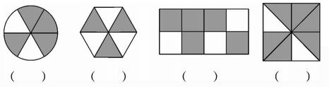

# Mathematics (Grade 6)

**ID**: e1f4d9e1
**难度**: medium_hard
**题型**: fill_in_the_blank

## 题目
用分数表示下面每个图形中的阴影部分。      

## 解答

**答案**: 4/6, 3/6, 5/8, 6/8

1. Step1:第一个图形把圆平均分成6份，阴影部分占4份，根据分数的意义，用分数表示为4/6
2. Step2:第二个图形把六边形平均分成6份，阴影部分占3份，根据分数的意义，用分数表示为3/6
3. Step3:第三个图形把长方形平均分成8份，阴影部分占5份，根据分数的意义，用分数表示为5/8
4. Step4:第四个图形把正方形平均分成8份，阴影部分占6份，根据分数的意义，用分数表示为6/8

## 知识点

**知识点**:
  - 分数的认识

---
