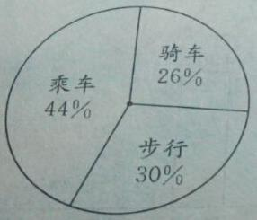

# Mathematics (Grade 6)

**ID**: e2584657
**难度**: medium_hard
**题型**: fill_in_the_blank

## 题目
六年级同学上学方式的情况如图所示，根据统计图可知，骑车上学的人数占六年级总人数的（）%，乘车上学的人数占六年级总人数的（）%，步行上学的人数占六年级总人数的（）%。

## 解答

**答案**: 26, 44, 30

1. Step1:观察扇形统计图，找到骑车部分对应的百分比标注为26%，可知骑车上学的人数占六年级总人数的26%
2. Step2:观察扇形统计图，找到乘车部分对应的百分比标注为44%，可知乘车上学的人数占六年级总人数的44%
3. Step3:观察扇形统计图，找到步行部分对应的百分比标注为30%，可知步行上学的人数占六年级总人数的30%

## 知识点

**知识点**:
  - 

---
