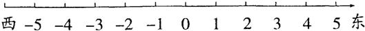

# Mathematics (Grade 6)

**ID**: e29d7040
**难度**: medium_hard
**题型**: fill_in_the_blank

## 题目

(1)小东在+3点的位置上，他走到-2点位置是向______走了______格．
(2)小东在+1点位置上，先向东走了3格，又向西走了8格，他最后停在______的位置上．

## 解答

**答案**: 西, 5, -4

1. Step1:根据正负数表示方向的规则，向东为正，向西为负。+3点走到-2点，数值从正变为负，所以是向西走
2. Step2:计算从+3点到-2点走的格数，用3 - (-2) = 5，所以走了5格
3. Step3:小东在+1点位置，先向东走3格，位置变为+1 + 3 = +4点
4. Step4:又向西走8格，位置变为+4 - 8 = -4点

## 知识点

**知识点**:
  - 负数的意义及其应用．

---
