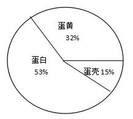

# Mathematics (Grade 6)

**ID**: e4712812
**难度**: medium_hard
**题型**: fill_in_the_blank

## 题目
鸡蛋中各部分质量统计图如下，妈妈买来80个鸡蛋，质量恰好是4千克，每天早晨萌萌都要吃一个鸡蛋，萌萌每天摄入的蛋白约有（   ）千克，蛋黄约有（   ）克

## 解答

**答案**: 26.5, 16

1. Step1:计算一个鸡蛋的质量，用总质量4千克除以鸡蛋个数80，即4÷80 = 0.05千克
2. Step2:将一个鸡蛋的质量0.05千克换算为克，因为1千克 = 1000克，所以0.05千克 = 0.05×1000 = 50克
3. Step3:计算萌萌每天摄入蛋白的质量，用一个鸡蛋的质量50克乘以蛋白所占的百分比53%，即50×53% = 26.5克，再换算为千克，26.5克 = 26.5÷1000 = 0.0265千克
4. Step4:计算萌萌每天摄入蛋黄的质量，用一个鸡蛋的质量50克乘以蛋黄所占的百分比32%，即50×32% = 16克

## 知识点

**知识点**:
  - --

---
