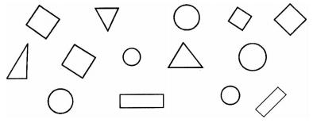

# Mathematics (Grade 6)

**ID**: e59c6d8b
**难度**: medium_hard
**题型**: fill_in_the_blank

## 题目
看图填空。

（1）正方形有（）个，长方形有（）个，三角形有（）个，圆有（）个，一共有（）个图形。
（2）（）最多，（）最少。
（3）三角形比正方形少（）个，圆比长方形多（）个。

## 解答

**答案**: 4, 2, 3, 5, 14, 圆, 长方形, 1, 3

1. Step1:按照一定顺序数出图中正方形的个数为4
2. Step2:按照一定顺序数出图中长方形的个数为2
3. Step3:按照一定顺序数出图中三角形的个数为3
4. Step4:按照一定顺序数出图中圆的个数为5
5. Step5:将正方形、长方形、三角形、圆的个数相加，4 + 2 + 3 + 5 = 14，得出图形总数为14
6. Step6:比较4、2、3、5的大小，5最大，2最小，所以圆最多，长方形最少
7. Step7:用正方形个数减去三角形个数，4 - 3 = 1，得出三角形比正方形少1个
8. Step8:用圆的个数减去长方形的个数，5 - 2 = 3，得出圆比长方形多3个

## 知识点

**知识点**:
  - 圆的认识;三角形的认识;长、正方形的认识;10以内数的加减法

---
