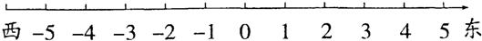

# Mathematics (Grade 6)

**ID**: e639eb68
**难度**: medium_hard
**题型**: fill_in_the_blank

## 题目

（1）小东在+3点的位置上，他走到-2点位置是向$\underline{\hspace{5em}}$走了$\underline{\hspace{5em}}$格．
（2）小东在+1点位置上，先向东走了3格，又向西走了8格，他最后停在$\underline{\hspace{5em}}$的位置上．

## 解答

**答案**: 西, 5, -4

1. Step1:确定方向正负规则，根据解析2可知向东走记为正，向西走记为负
2. Step2:分析（1），从+3点位置走到-2点位置，位置数值减小，根据正负规则可知是向西走，计算格数为3 - (-2) = 5格
3. Step3:分析（2），小东在+1点位置，先向东走3格，位置变为+1 + 3 = +4，又向西走8格，位置变为+4 - 8 = -4

## 知识点

**知识点**:
  - 负数的意义及其应用．

---
