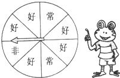

# Mathematics (Grade 6)

**ID**: e6fef828
**难度**: medium_hard
**题型**: fill_in_the_blank

## 题目
转动转盘，指针停在______“字”的可能性最大，停在______“字”的可能性最小．

## 解答

**答案**: 好, 非

1. Step1:观察转盘图，可知大转盘被平均分成8份
2. Step2:数出“好”字占有5份
3. Step3:数出“常”字占有2份
4. Step4:数出“非”字占有1份
5. Step5:比较份数，5＞2＞1，份数越多指针停在该区域可能性越大，所以指针停在“好”字的可能性最大
6. Step6:因为1最小，所以指针停在“非”字的可能性最小

## 知识点

**知识点**:
  - 可能性的大小．

---
