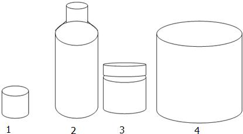

# Mathematics (Grade 6)

**ID**: e7df25ff
**难度**: medium_hard
**题型**: fill_in_the_blank

## 题目
在横线里填上“升”或“亳升”

图1一杯橘子汁500______，
图2一瓶油2.5______，
图3一瓶果汁1______，
图4一缸水600______．

## 解答

**答案**: 毫升, 升, 升, 升

1. Step1:根据生活经验、对容积单位和数据大小的认识，判断一杯橘子汁的容积，通常一杯橘子汁是500毫升，所以图1横线处填毫升
2. Step2:同样依据上述认知，一瓶油的容积较大，2.5升比较符合实际，所以图2横线处填升
3. Step3:考虑一瓶果汁的常见容积，1升是合理的，所以图3横线处填升
4. Step4:一缸水的量相对较多，600升符合其容积特点，所以图4横线处填升

## 知识点

**知识点**:
  - 体积、容积及其单位．

---
