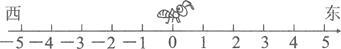

# Mathematics (Grade 6)

**ID**: ee04b527
**难度**: medium_hard
**题型**: fill_in_the_blank

## 题目
下图中每小格表示1dm，蚂蚁现在的位置在起点0处。

（1）如果把蚂蚁从起点向东爬行4dm记作+4dm，那么它从起点向西爬行3dm应记作________dm。   
（2）如果蚂蚁的位置是-4dm，说明它从起点向________爬行了________dm。   
（3）如果蚂蚁从起点先向西爬行了1dm，又向东爬行了3dm，这时它的位置应记作________dm。   
（4）如果蚂蚁要从起点到+3.5dm处，应该向________爬行________dm。

## 解答

**答案**: -3, 西, 4, +2, 东, 3.5

1. Step1:根据正负数表示相反意义的量，向东记为正，那么向西就记为负，所以从起点向西爬行3dm应记作-3dm
2. Step2:位置是-4dm，负号表示方向向西，数值4表示爬行的距离，所以说明它从起点向西爬行了4dm
3. Step3:从起点先向西爬行了1dm记作-1dm，又向东爬行了3dm记作+3dm，-1 + 3 = +2，这时它的位置应记作+2dm
4. Step4:要到+3.5dm处，正号表示方向向东，数值3.5表示爬行的距离，所以应该向东爬行3.5dm

## 知识点

**知识点**:
  - 小学数学;数与代数;数的认识

---
